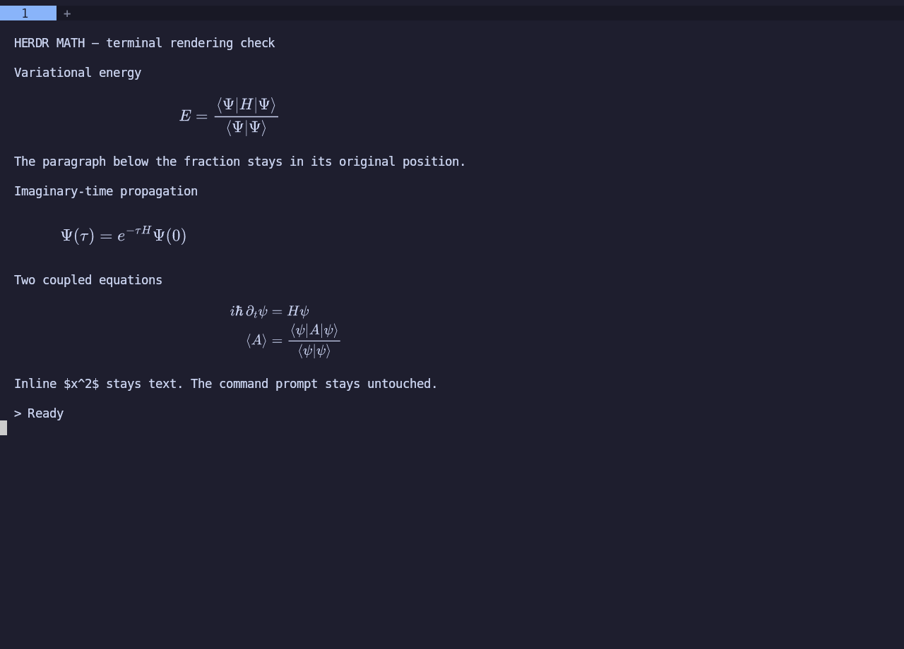

# herdr-math

Render inline and display LaTeX equations inside [Herdr](https://herdr.dev) terminal panes using MathJax and Resvg.



## Install

Requires Node.js 20+, npm, Python 3, Herdr 0.9.2+, and a Kitty-graphics-compatible terminal such as Kitty, Ghostty or WezTerm (GNOME Terminal cannot show images). Tested on Linux with Kitty and Herdr 0.9.5.

Open Herdr in your compatible terminal, then install the plugin and [writing skill](skills/herdr-math/SKILL.md):

```sh
herdr plugin install liambern/herdr-math
npx skills add liambern/herdr-math --skill herdr-math -g
```

Select your agents in the skill installer. Switch panes once after installation, and start a fresh agent conversation to load the skill.

The plugin enables Kitty graphics, starts with Herdr, and follows the active pane. If graphics were disabled in an existing session, reattach your terminal or restart the Herdr server.

Herdr 0.9.2 removed its plugin graphics API, so the plugin writes standard Kitty graphics to the active pane's own terminal, which Herdr renders natively. Rendered math scrolls with the text; while you scroll back, the plugin leaves it in place and refreshes once the pane is back at the bottom.

## Use

Ask your agent: **“Show me Schrödinger’s equation. Use herdr-math.”**

The skill lets agents use ordinary inline and display LaTeX without a fixed template. The plugin renders visible terminal text independently of the agent harness. For example, `The energy is $E=mc^2$.` renders math within prose; `\(E=mc^2\)` also works. Code spans, code fences, escaped dollar signs, and ordinary currency amounts stay text.

Display equations share the center of the current pane width, use a full-width background band across their source rows, and recenter when the layout changes. Inline images cover only their original source span; display images cover their source rows. Neither mode reflows surrounding text, so tall equations need enough source lines. Incomplete, invalid, partially visible, or cramped equations remain text. Inline expressions that wrap across terminal rows stay text. The original source remains available for copying.

To quickly reveal the LaTeX source, invoke `herdr plugin action invoke herdr-math.toggle`. This hides or shows all math overlays in the session while keeping the plugin and its caches running; restarting the renderer restores visibility. Bind it to **Ctrl+B, then M** (with the default prefix) by adding this to your Herdr config and running `herdr server reload-config`:

```toml
[[keys.command]]
key = "prefix+m"
type = "plugin_action"
command = "herdr-math.toggle"
description = "Show or hide math overlays"
```

To pause rendering, run `herdr plugin disable herdr-math`. To resume, run `herdr plugin enable herdr-math` and switch panes.

## Update

```sh
herdr plugin update herdr-math
npx skills update herdr-math
```

Switch panes once after updating. See the [latest release](https://github.com/liambern/herdr-math/releases/latest) for changes.

## License

[MIT](LICENSE).
